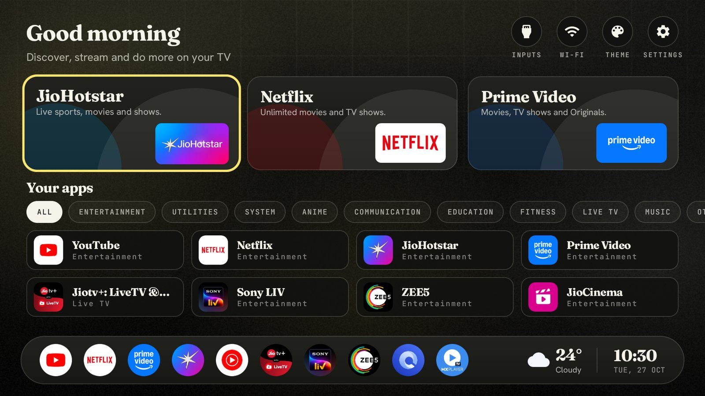
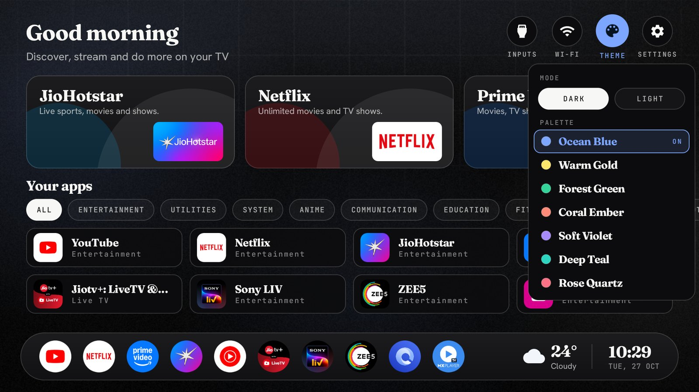
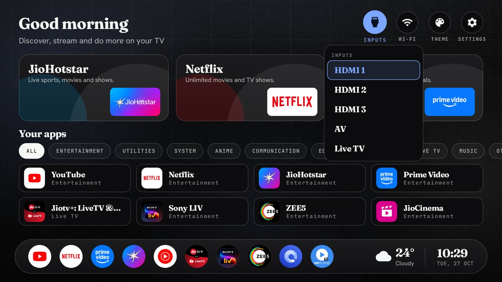
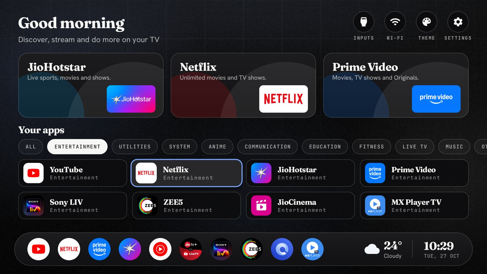
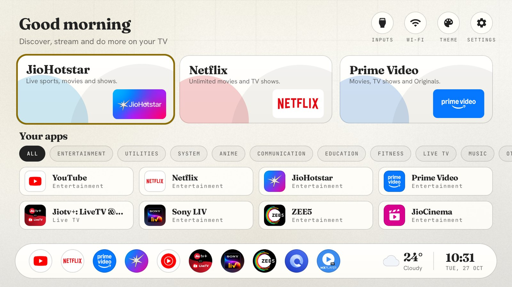
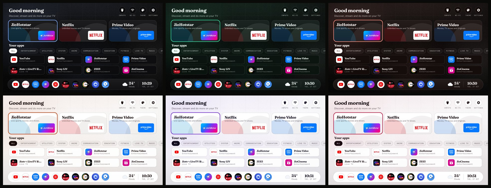

<h1 align="center">Noirly TV</h1>

<p align="center">
  A quiet, editorial home screen for Android TV and Google TV, in the Noirly design language.<br>
  Seven palettes, light and dark, no ads, and nothing on the TV uninstalled.
</p>

<p align="center">
  
</p>

Noirly TV takes a stock Android TV, switches off the manufacturer's ads, telemetry and preloaded apps, and
replaces its home screen with **Studio Home**: three large cards for the apps you use most, your apps in
category tabs, a bar with your favourites, the weather and the clock. It is built on
[Clean Your TV](CLEANYOURTV.md), so every change is a reversible `pm disable-user`. There is no root and
no flashing, and a one-line restore puts the TV back as it was.

## Screenshots

| | |
|---|---|
|  |  |
| *Theme: dark or light, and seven palettes* | *Inputs: HDMI ports, AV and Live TV* |
|  |  |
| *Category tabs filter Your apps as you move along them* | *Warm Gold, light* |



## What's on the screen

| Part | What it does |
|---|---|
| **Greeting** | Good morning, afternoon or evening, with an optional name, in Inter Display. |
| **Inputs, Wi-Fi, Theme, Settings** | Round buttons. Inputs lists the HDMI ports, AV and Live TV. The Wi-Fi icon is green when online, orange when connected without internet and red when offline. Theme opens the palette picker. Hold OK on Settings for the launcher's own settings. |
| **Three app cards** | Your three main apps, each with its banner, a tagline and a soft glow in its own colour. Hold OK on a card to choose any installed app for it; an app already on another card swaps places, and **Default** goes back to the theme's choice. |
| **Your apps** | Every app as a card with its category, two rows at a time. Tabs above it (All, Entertainment, Music, …, Other) filter the grid as you move along them. |
| **The bar** | Round icons of your favourite apps, the weather now and the clock with the date. |
| **Background** | Noirly's ambient page: a light from the top, a faint blueprint grid, soft accent glows, a vignette and fine grain. It is drawn once, so it costs nothing while you watch. |

D-pad: Up and Down move between the buttons, the cards, the tabs, the grid and the bar. Left and Right move
along a row. Home returns to the first card.

## The Noirly look

The colours and type come from the Noirly design system, the same one as the Noirly web apps:

- **Seven palettes:** Ocean Blue, Warm Gold, Forest Green, Coral Ember, Soft Violet, Deep Teal and Rose Quartz.
  Each comes in dark and light. Every colour on the screen comes from the palette's five base colours
  (background, surface, text, accent and accent ink), worked out the same way as the web build.
- **Type:** [Inter Display](https://rsms.me/inter/) (an open SF Pro look-alike) for titles and numbers,
  [Hanken Grotesk](https://fonts.google.com/specimen/Hanken+Grotesk) for text and
  [JetBrains Mono](https://fonts.google.com/specimen/JetBrains+Mono) in capitals for labels. The launcher
  carries small Latin subsets of each; any other character falls back to the TV's own font.
- **States:** focus is a ring in the accent colour, and a chosen tab or mode turns solid.

Choose a palette and mode with the **Theme** button. The TV remembers the choice.

## Weather

The launcher never goes online: it has no `INTERNET` permission. The weather comes from the
[Weather add-on](addons/weather/README.md), a separate app that reads [Open-Meteo](https://open-meteo.com/).
It sends only the city name you search for, then that city's coordinates. No account or key is needed.
The add-on shares the current reading with Home through a read-only provider. It fetches at most every
30 minutes, and only when Home asks for it. The bar shows an icon for the conditions (sun, moon, partly
cloudy, cloud, fog, rain, snow, storm), the temperature, the conditions and the city. Without the add-on,
the weather simply isn't shown.

## Set it up

You need the TV and a computer on the same Wi-Fi, with Python 3, JDK 17 and the Android SDK (platform 34,
build-tools 34.0.0).

1. **On the TV**, switch on developer options (Settings → Device Preferences → About → press OK on
   **Build** seven times) and turn on **USB debugging**. If there is a Network or ADB debugging toggle, turn
   that on too.
2. **Clone this repository** and make the tools' Python environment:

   ```bash
   git clone https://github.com/aneesh-pissay/noirly-tv
   cd noirly-tv
   python3 -m venv tools/venv
   tools/venv/bin/pip install -r tools/requirements.txt
   ```

   On Windows, the pip path is `tools/venv/Scripts/pip`.
3. **Debloat**, if you want to. Open the folder in a coding assistant (Claude Code, Codex or Gemini CLI) and
   paste [`PROMPT.md`](PROMPT.md). It backs up the TV, asks before touching anything you use and disables
   the rest. To do it by hand, see [the Clean Your TV guide](CLEANYOURTV.md) and the tested lists in
   [`examples/`](examples/README.md).
4. **Install the launcher** as the home screen:

   ```bash
   TV_HOST=<tv ip> launcher/build-and-install.sh
   ```

5. **Turn on Studio Home** with a theme folder that holds a `config.json` (see below), then push it:

   ```bash
   TV_HOST=<tv ip> tools/theme.sh my-theme
   ```

6. **Add the weather** (optional):

   ```bash
   cd addons/weather && ./gradlew assembleRelease
   TV_HOST=<tv ip> ../../tools/venv/bin/python -I ../../tools/tv.py --push app/build/outputs/apk/release/app-release.apk /data/local/tmp/addon.apk
   TV_HOST=<tv ip> ../../tools/venv/bin/python -I ../../tools/tv.py 'pm install -r /data/local/tmp/addon.apk; rm -f /data/local/tmp/addon.apk'
   ```

   Press OK on the weather in the bar and choose your city.

When you're done, switch USB debugging off again. Port 5555 is plain text.

## `config.json`

A minimal Studio Home theme:

```json
{
  "studio_home": true,
  "greeting_name": "Sam",
  "dock_apps": ["com.netflix.ninja", "com.google.android.youtube.tv", "com.amazon.amazonvideo.livingroom"],
  "studio_dock": ["com.google.android.youtube.tv", "com.netflix.ninja", "com.spotify.tv.android"],
  "studio_palette": "gold",
  "studio_mode": "dark"
}
```

| Key | What it sets |
|---|---|
| `studio_home` | `true` turns Studio Home on. Without it the launcher shows its classic home. |
| `greeting_name` | The name after the greeting. Leave it out for just "Good morning". |
| `studio_subtitle` | The line under the greeting. |
| `dock_apps` | The first three are the large app cards, until you pick others by holding OK on a card. |
| `studio_apps` | Which apps come first in Your apps, in order. The rest follow by name. |
| `studio_dock` | The round icons in the bar. |
| `studio_taglines`, `studio_categories` | Objects keyed by package, for a card's tagline and an app's category tab. |
| `hidden_apps` | Packages to leave off Home. |
| `live_tv_package` | The TV app that the Inputs list's Live TV opens. |
| `studio_palette`, `studio_mode` | The starting palette (`blue`, `gold`, `forest`, `coral`, `violet`, `teal`, `rose`) and `dark` or `light`. The Theme button overrides both. |
| `studio_weather_place` | `false` hides the city in the weather. |
| `wifi_label_width` | Width in dp for the network name under the Wi-Fi button, cut with an ellipsis ("Offline" when there is none). `0`, the default, keeps the label "Wi-Fi". |
| `settings_key_keycodes` | Remote buttons that open Settings while Home is on screen, by keycode. A TCL Google TV gear sends `[83]`; to find yours, press it on Home and read `adb logcat -s NoirlyHome`. `settings_key_panel: true` opens the quick settings panel instead. |

## Undo

Everything here can be undone. `tools/restore.sh` with the same list re-enables every package, and
[the Clean Your TV guide](CLEANYOURTV.md#restoring-your-tv) covers putting the stock launcher back.

## Where things are

| Path | What it is |
|---|---|
| `launcher/` | The launcher (plain Java, `minSdk` 26, no network). Studio Home is `StudioHome.java`, the palettes are `NoirlyPalette.java` and the background is `NoirlyBackdrop.java`. |
| `addons/weather/` | The Weather add-on and its `NowProvider`. |
| `tools/` | The ADB client (`tv.py`) and the debloat, restore, theme and check scripts. |
| `examples/` | Tested debloat lists for hundreds of TV models. |
| `CLEANYOURTV.md` | The full Clean Your TV guide: how it works, every supported TV, doing it by hand, restoring, and troubleshooting. |
| [`AGENTS.md`](AGENTS.md) | Instructions for coding agents working on a TV or on this repository. |

## Credits and licence

Noirly TV is a fork of [Clean Your TV](https://github.com/Gathin23/cleanyourtv) by Gathin and its contributors.
The debloat lists, tools and launcher base come from that project. The Weather add-on is by
[Sumyabazar1](https://github.com/Sumyabazar1), and its data comes from [Open-Meteo](https://open-meteo.com/).
Inter, Hanken Grotesk and JetBrains Mono are under the SIL Open Font Licence.

Released under the [MIT licence](LICENSE), as the original is.
