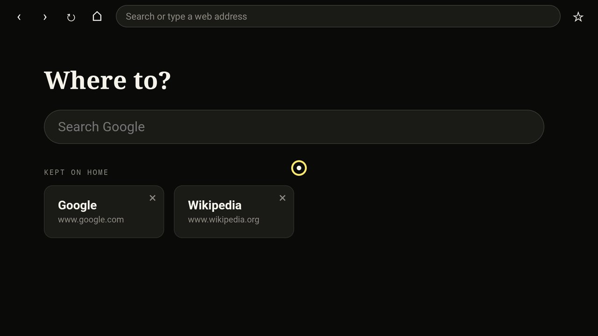

# TV Browser

The web with a TV remote. Chrome has no Android TV version, and sites are built for a mouse, so this add-on opens
them in the TV's own WebView (the Chromium engine Chrome is built on) and gives the remote a pointer. For the
[Noirly TV](../../README.md) launcher it is also a module card. On any other Android TV home it is an ordinary app.
Tested on a TCL G09 (Google TV 12).



## The remote

| Key | On a page | In a fullscreen video |
|---|---|---|
| Arrows | Move the gold pointer, faster the longer you hold. Past an edge the page (or the list under the pointer) scrolls. | Seek and volume, the player's own keys |
| OK | Click where the pointer is; hold for a long press. On a video, play / pause. | Play / pause |
| Play/pause key | Play / pause | Play / pause |
| Back | Close the keyboard, then go back a page, then leave the app | Leave fullscreen |

The bar along the top is pressed with the pointer too: Back, Forward, Reload, Home, the address, and the star.
Moving the pointer is a mouse move, so menus and hover states open as they do on a computer. Clicking a text field
opens the TV's keyboard, and a field on a page is lifted above it so you see what you type.

## What it does

- **The address bar** takes a web address (`wikipedia.org`) or words, which become a Google search.
- **Home** is drawn by the app, never fetched: a Google search box and the pages you keep, as tiles. The **star**
  keeps the page you are on (filled gold when it is kept, press again to take it off); the **×** on a tile takes
  it off Home. Google and Wikipedia are there to start with.
- Loads the **desktop site**, which reads well from the sofa; the phone sites mostly push you to install an app.
- **Video** plays with the TV's hardware decoder, protected (Widevine) video included. A player's fullscreen
  button takes the whole screen, with the screen kept awake while it plays. Players that cancel a tap (Udemy's
  Shaka) or take it as "show the controls" (YouTube) still answer OK: their buttons and sliders are clicked from
  the page, and OK on the video itself plays or pauses.
- Reopens on the **page you left**. A web link handed to it opens that page: another app's, or
  `am start -n dev.noirly.tv.browser/.BrowserActivity -d <link>`; the TV may offer it as the app for web links.
- One tab. Links that open a new window open here. Links to other apps (`intent:`, `market:`) and downloads are
  ignored.

What it cannot do: your Chrome account, its bookmarks, history and saved passwords, or extensions. **Google sign-in
doesn't work** on sites: Google refuses to sign in inside an app's web view. Sites that offer sign-in by email (a
code or a password) work.

## Permissions

| Permission | Why |
|---|---|
| `INTERNET` | The web. |

Plain `http://` pages load too (`usesCleartextTraffic`), as in Chrome: a router's settings page or an old site
has nothing else. What you type without `http://` is opened over HTTPS.

There is nothing else: no analytics and no background service. Cookies, site storage and the pages kept on Home
stay in the app's private storage (backups off). The camera, the microphone and location are refused to every site.

## Build and install

JDK 17 and Android SDK platform 34, as for the launcher:

```bash
cd addons/tv-browser && ./gradlew assembleRelease
TV_HOST=<tv ip> ../../tools/venv/bin/python -I ../../tools/tv.py --push app/build/outputs/apk/release/app-release.apk /data/local/tmp/addon.apk
TV_HOST=<tv ip> ../../tools/venv/bin/python -I ../../tools/tv.py 'pm install -r /data/local/tmp/addon.apk; rm -f /data/local/tmp/addon.apk'
```

On Windows in Git Bash, run `export MSYS_NO_PATHCONV=1` first, and use `../../tools/venv/Scripts/python.exe`.
Otherwise Git Bash turns `/data/local/tmp/addon.apk` into a Windows path, the push fails with
`secure_mkdirs failed: No such file or directory`, and `pm install` finds no file.

The release build is signed with the debug key so it installs over ADB. No libraries: plain Android WebView, about
20 KB.
