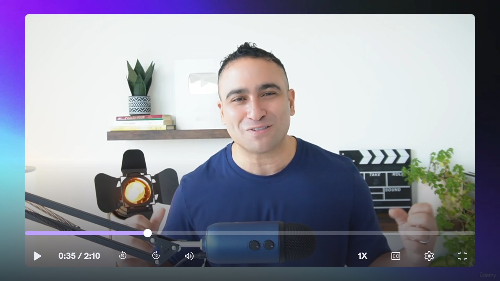

# Udemy TV

[udemy.com](https://www.udemy.com/) made usable with a TV remote. Udemy has no Android TV app, and the site is
built for a mouse, so this add-on opens the desktop site full screen and gives the remote a pointer. For the
[Noirly TV](../../README.md) launcher it is also a module card. On any other Android TV home it is an ordinary app.



## The remote

| Key | On a page | In a fullscreen video |
|---|---|---|
| Arrows | Move the gold pointer, faster the longer you hold. Past an edge the page (or the list under the pointer) scrolls. | Seek and volume, the player's own keys |
| OK | Click where the pointer is; hold for a long press | Play / pause |
| Play/pause key | Play / pause | Play / pause |
| Back | Close the keyboard, then go back a page, then leave the app | Leave fullscreen |

Moving the pointer is a mouse move, so menus and hover states open as they do on a computer. Clicking a text
field opens the TV's keyboard, and the field is lifted above it so you see what you type.

## Signing in

Use **Email or Phone Number** on Udemy's log-in page: Udemy sends a one-time code to your email or phone, and you
type it with the TV keyboard. The sign-in is kept (the web view's cookies), so it's needed only once. **Google,
Facebook and Apple sign-in don't work here**: those providers refuse to sign in inside an app's web view. The app
says so instead of showing their error page.

## What it does

- Loads the **desktop site** at 1280 CSS pixels across, so the layout reads well from the sofa. The phone site
  mostly pushes you to install the phone app.
- **Lecture video** plays with the TV's hardware decoder. Protected (Widevine) video is allowed. The player's
  fullscreen button takes the whole screen, with the screen kept awake while it plays.
- Reopens on the **page you left**. A `https://www.udemy.com/...` link handed to it opens that page:
  `am start -n dev.noirly.tv.udemy/.UdemyActivity -d <link>`.
- Links to other apps (`intent:`, `market:`) are ignored rather than leaving the app.

## Permissions

| Permission | Why |
|---|---|
| `INTERNET` | udemy.com and its videos. |

There is nothing else: no analytics and no background service. Everything Udemy stores stays in the app's private
web storage (backups off).

## Build and install

JDK 17 and Android SDK platform 34, as for the launcher:

```bash
cd addons/udemy-tv && ./gradlew assembleRelease
TV_HOST=<tv ip> ../../tools/venv/bin/python -I ../../tools/tv.py --push app/build/outputs/apk/release/app-release.apk /data/local/tmp/addon.apk
TV_HOST=<tv ip> ../../tools/venv/bin/python -I ../../tools/tv.py 'pm install -r /data/local/tmp/addon.apk; rm -f /data/local/tmp/addon.apk'
```

On Windows in Git Bash, run `export MSYS_NO_PATHCONV=1` first, and use `../../tools/venv/Scripts/python.exe`.
Otherwise Git Bash turns `/data/local/tmp/addon.apk` into a Windows path, the push fails with
`secure_mkdirs failed: No such file or directory`, and `pm install` finds no file.

The release build is signed with the debug key so it installs over ADB. No libraries: plain Android WebView, about
15 KB.
